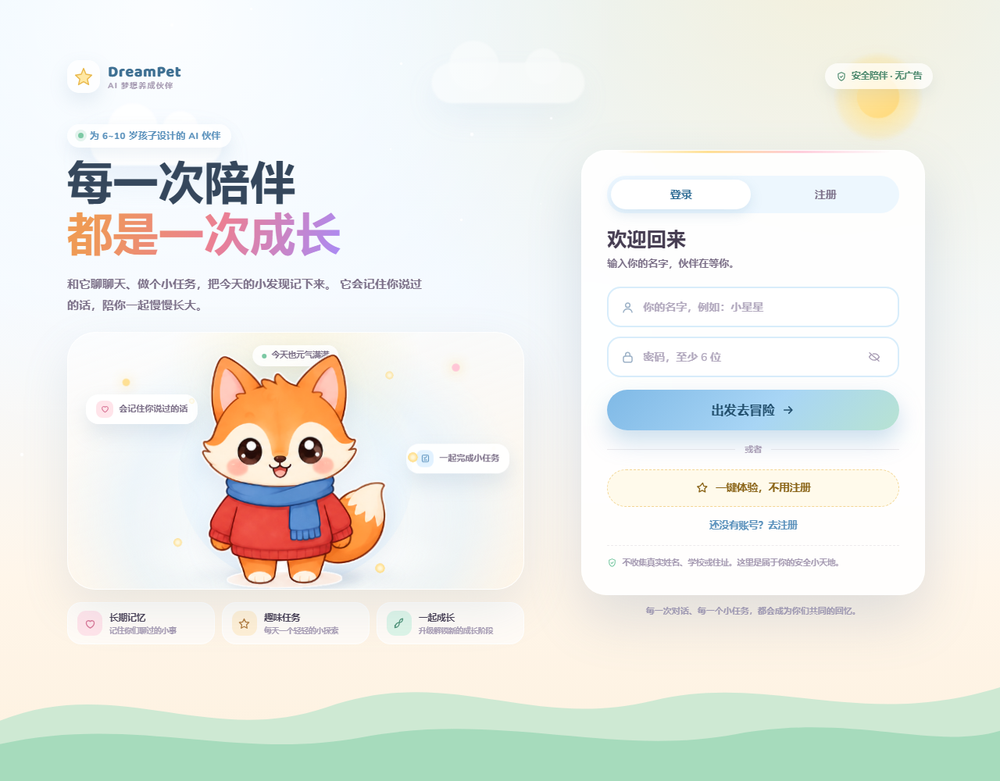
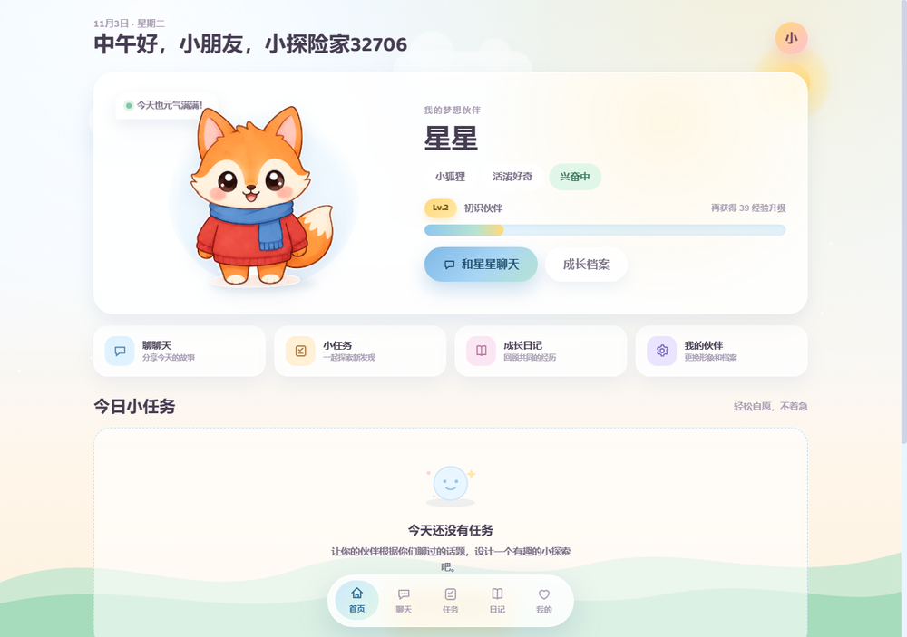
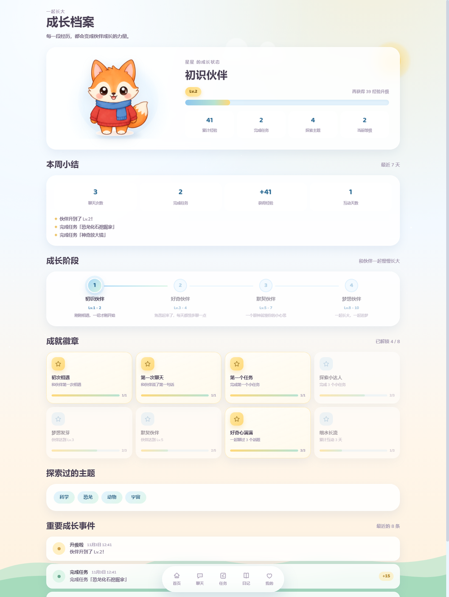

# DreamPet · AI 梦想养成伙伴

> 每一次陪伴，都是一次成长。

DreamPet 是面向 **6~10 岁儿童**的 AI 虚拟伙伴与创意成长陪伴平台。孩子创建一个属于自己的伙伴，和它自由聊天、一起做趣味小任务、记录成长，伙伴会记住共同经历并逐渐长大。

**核心三件事：长期记忆 · 主动陪伴 · 成长反馈。**

**在线体验：<http://8.134.105.111/dreampet/>**（已部署在阿里云服务器）

- 仅使用**真实文本大模型**（OpenAI 兼容接口）；**不调用任何图片生成、语音合成、语音识别模型**
- 宠物形象 = 用户提供的 5 个冬装角色素材（已抠图为透明 PNG，本地存放）+ CSS 动画（5 种物种 × 4 个成长阶段），不依赖外链图片
- **意图识别**：规则优先 + 大模型兜底，驱动任务推荐、回忆、情绪安抚等回应策略
- **儿童安全**：自伤、被欺凌、想伤害他人、危险行为等由代码级规则先行拦截并给出引导话术
- **失败可观测**：模型超时 / 限流 / 认证失败 / 未配置 Key 均返回明确错误码与儿童友好提示
- 后端掌控等级/经验/奖励，AI 只负责语言与任务创意
- 面向 **低配环境**设计：无 Redis/Kafka 等中间件，单机小内存即可运行；当前部署在阿里云 2C/1.7G 服务器，CloudBase 免费版为备选方案

## 界面预览

<p align="center">
  
  
</p>

<p align="center">
  
</p>

## 目录

- [功能一览](#功能一览)
- [技术栈](#技术栈)
- [本地启动](#本地启动)
- [环境变量](#环境变量)
- [测试与验证](#测试与验证)
- [项目结构](#项目结构)
- [文档](#文档)
- [儿童安全与隐私](#儿童安全与隐私)
- [部署状态](#部署状态)

## 功能一览

| 模块 | 说明 |
|---|---|
| 创建伙伴 | 5 种物种、名字、性格；不预选兴趣，话题由聊天自然产生；设置中可随时更换物种，成长与记忆保留 |
| AI 聊天 | 结合伙伴性格、聊天中形成的话题记忆、当前任务自由对话（想聊什么都可以）；支持「开启新对话」，清空窗口但保留长期记忆 |
| 意图识别 | 11 类意图（打招呼/兴趣/梦想/任务/回忆/情绪/提问等），影响任务推荐与回应策略 |
| 今日任务 | TaskAgent 按聊天话题生成；结构化校验 + 服务端奖励截断；待办任务可置为进行中 |
| 成长系统 | 任务/聊天获得经验 → 升级 → 4 个成长阶段 → 成长动画 |
| 成就与周报 | 8 枚成就徽章（初次相遇、探索小达人等）+ 本周小结（聊天/任务/经验/互动天数） |
| 成长日记 | 按天聚合的「每日回顾」（聊天次数/任务数/经验/高光）、重要记忆、对话摘要 |
| 长期记忆 | 话题/事件/画像/任务/摘要五层记忆，重启不丢 |
| 儿童安全 | 代码级安全分类 + 输入输出双向过滤 + 隐私提醒 + 危险话题引导求助 |
| 失败处理 | 超时/限流/认证/未配置 结构化错误码（502/503/504）+ 友好提示 + 自动重试 1 次 |
| 部署与保护 | `/api/health` 健康检查、每用户每小时 AI 调用限流（429）、小实例内存/连接池调优、PWA 安装 |
| 账号与登录 | 登录 / 注册 / 一键体验；设置页顶部与账号卡片均可退出登录（二次确认，数据保留） |
| 数据隔离 | 所有查询强制 user_id，账号可一键删除全部数据 |

## 技术栈

| 层 | 选型 |
|---|---|
| 前端 | Vue 3 + TypeScript + Vite + Pinia + Vue Router（hash 模式）+ SCSS + Axios |
| 后端 | Java 17 + Spring Boot 3.3 + MyBatis-Plus 3.5 |
| 数据库 | H2 文件库（PostgreSQL 兼容，当前线上使用）/ 可选 CloudBase PostgreSQL |
| AI | 真实 OpenAI 兼容文本大模型（DeepSeek / 智谱 / Moonshot 等） |
| 部署 | 当前：阿里云服务器 Nginx + systemd + H2；备选：CloudBase 云托管 + 静态托管 + PostgreSQL |

## 本地启动

**环境**：JDK 17、Maven 3.9+、Node 18+（推荐 20+）。

```bash
# 1. 启动后端（真实 AI 模式，H2 文件库，端口 8080）
export LLM_API_KEY=你的Key          # Windows CMD: set LLM_API_KEY=你的Key
cd backend
mvn spring-boot:run
# 或 Windows: scripts\start-backend.bat   /  macOS·Linux: bash scripts/start-backend.sh

# 2. 启动前端（端口 5173）
cd frontend
npm install
npm run dev
```

打开 http://localhost:5173 → 一键体验 → 创建伙伴。

- 健康检查：`GET http://localhost:8080/api/health` → `{"status":"ok","db":"up"}`
- 演示「重新进入记得你」：后端加 `GREETING_IDLE_MINUTES=0` 启动，欢迎语会立即触发
- 数据默认保存在 `backend/data/`，重启不丢失；删除该目录即可清空本地数据

**生产构建**：`VITE_API_BASE` 注入 API 地址，`VITE_BASE` 注入部署子路径；项目使用 hash 路由，无需配置 404 回退。

```bash
# 当前阿里云部署（Nginx 子路径 /dreampet/）
cd frontend
MSYS_NO_PATHCONV=1 VITE_BASE=/dreampet/ VITE_API_BASE=/dreampet/api npm run build
# Windows PowerShell:
# $env:VITE_BASE="/dreampet/"; $env:VITE_API_BASE="/dreampet/api"; npm run build

# CloudBase / 独立域名部署
VITE_API_BASE=https://<后端域名>/api npm run build
```

## 环境变量

完整模板见 [`.env.example`](.env.example) 与 [`frontend/.env.example`](frontend/.env.example)。

| 变量 | 必填 | 说明 |
|---|---|---|
| `LLM_API_KEY` | 是 | 文本大模型 Key，仅存后端环境变量 |
| `LLM_BASE_URL` / `LLM_MODEL` | 是 | OpenAI 兼容地址与模型名 |
| `LLM_READ_TIMEOUT_MS` / `LLM_MAX_TOKENS` | 否 | 默认 30000 / 600 |
| `AUTH_SECRET` | **prod 强制** | Token 签名密钥，至少 16 位随机值。生产未配置、仍为默认值或过短时**服务拒绝启动** |
| `CORS_ALLOWED_ORIGINS` | **prod 强制** | 前端静态托管域名（逗号分隔）。生产留空或填 `*` 时**服务拒绝启动** |
| `GREETING_IDLE_MINUTES` | 否 | 欢迎语空闲阈值，默认 30 |
| `INTENT_LLM_ENABLED` | 否 | 意图识别 LLM 兜底；生产默认关闭 |
| `CHAT_RATE_LIMIT` / `TASK_RATE_LIMIT` | 否 | 每用户每小时 AI 调用上限，默认 40 / 12 |
| `SPRING_PROFILES_ACTIVE` | **部署必传** | `local`（默认）/ `prod`。生产漏传会被启动自检拦截（见下） |
| `DB_HOST` / `DB_PORT` / `DB_NAME` / `DB_USER` / `DB_PASSWORD` | prod | CloudBase PostgreSQL 连接信息 |
| `VITE_API_BASE` | 构建时 | 前端 API 地址；本地 `/api`，当前线上 `/dreampet/api` |
| `VITE_BASE` | 构建时 | 前端部署路径；根路径 `/`，当前线上 `/dreampet/` |

> AI 失败统一转换为结构化响应：未配置 Key → 503；认证失败/上游异常 → 502；超时 → 504；触发用户频率限制 → 429。

### 生产启动安全自检

只要激活了任意一个非 `local` / `test` 的 profile（包括 `local,prod` 同时激活），`StartupSecurityValidator` 就会强制校验以下各项，任一不满足即**拒绝启动并打印原因**（宁可起不来，也不带着不安全配置上线）：

1. `AUTH_SECRET` 已显式配置、不等于仓库中公开的默认值/示例占位值、长度 ≥ 16
2. `CORS_ALLOWED_ORIGINS` 已显式配置且不包含通配 `*`
3. 数据源不是 H2，且 H2 控制台未启用

第 3 项用于拦截在 prod profile 下误用 H2 / 开启 H2 控制台的情况。为避免「容器漏传 `SPRING_PROFILES_ACTIVE` 后退回 local」的高危场景，**Dockerfile 已默认设置 `ENV SPRING_PROFILES_ACTIVE=prod`**；容器与云托管即使漏传该变量也不会使用 H2。若直接以 jar 方式部署，请务必显式设置 prod。H2 控制台由 Spring Boot 注册为**独立 Servlet**，不经过登录拦截器，项目也未引入 `spring-boot-starter-security`，因此没有额外兜底——控制台一旦在公网开启就等同于开放数据库。

### 已知边界与安全取舍

以下是在「CloudBase 免费体验版、不引入中间件」约束下的有意取舍，部署前请知悉：

- **调用限流是单实例内存计数**（`RateLimitService`）。计数随进程存活，因此：① 实例冷启动或重新调度后计数归零；② 若未来扩为多实例，实际限额约为 `配置值 × 实例数`。它的目的是防止公网刷爆模型费用，而非精确配额，不应作为计费级的强保证。若需跨实例精确限流，需要引入 Redis 等共享存储。
- **前端 Token 存放在 `localStorage`**（`frontend/src/api/http.ts`）。在「静态托管 + 跨域 API」架构下，`HttpOnly` Cookie 需要同站部署，与当前架构冲突，故采用 `Authorization` 头传递 JWT。代价是**该存储对 XSS 不设防**：若页面被注入脚本，Token 可被读取。由于聊天内容涉及儿童情绪与家庭信息，上线前应确保不引入未经审查的第三方脚本，并保持依赖更新。
- 鉴权**不依赖 Cookie**，因此 CORS 未开启 `allowCredentials`；跨域配置收紧的主要目的是防止第三方站点滥用免登录接口（如批量创建游客账号）。

## 测试与验证

```bash
# 后端测试（H2 内存库 + 测试专用确定性客户端，不调用外部模型、不产生费用）
cd backend && mvn test

# 端到端冒烟（使用真实 AI，需要 LLM_API_KEY）
SAVE_TOKEN_FILE=/tmp/dreampet-token.txt node scripts/smoke-test.mjs

# 意图识别演示
node scripts/intent-demo.mjs /tmp/dreampet-token.txt

# 重启后端后验证伙伴/记忆/任务持久化
node scripts/verify-restart.mjs /tmp/dreampet-token.txt
```

当前结果：后端 **108 项测试全部通过**，前端类型检查与生产构建通过，真实 AI 聊天/任务/反馈、安全引导、重启持久化均已实测。线上部署完成后再次通过了端到端冒烟、桌面（1440px）与移动端（390px）浏览器渲染检查，控制台 0 报错。详见 [测试报告](docs/TEST-REPORT.md)。

## 项目结构

```
dream-pet/
├── backend/                       Spring Boot 后端
│   ├── src/main/java/com/dreampet/
│   │   ├── agent/                 CompanionAgent / TaskAgent / MemoryManager / SafetyGuard / IntentRecognizer
│   │   ├── controller/            REST 接口（认证/伙伴/聊天/任务/成长/记忆/健康检查）
│   │   ├── service/               Auth / Pet / Chat / Task / Growth / Memory / Achievement / RateLimit
│   │   ├── llm/                   LlmService + OpenAI 兼容客户端 + 结构化错误
│   │   ├── entity/ mapper/ dto/ config/ common/ util/
│   │   └── resources/db/          schema-h2.sql / schema-postgres.sql
│   ├── src/test/                  集成测试 / 意图 / 安全 / 限流 / LLM 单测
│   └── Dockerfile                 云托管镜像
├── frontend/                      Vue 3 + TypeScript 前端
│   ├── src/views/                 欢迎/创建/首页/聊天/任务/成长/日记/设置
│   ├── src/components/            宠物形象、成长条、任务卡、升级动画等
│   ├── src/stores/ api/ router/   状态、接口、hash 路由
│   ├── src/assets/pets/           5 个透明角色素材（PNG）
│   └── public/                    PWA manifest / sw.js / icons
├── docs/                          架构 / API / 数据库 / 记忆 / 部署 / 演示 / 测试报告
│   ├── images/                    README 截图
│   └── assets/                    角色素材源图
├── scripts/                       启动脚本 + 冒烟 / 意图 / 重启验证脚本
├── .env.example                   环境变量模板（无真实密钥）
└── README.md
```

## 文档

- [技术架构](docs/ARCHITECTURE.md)
- [API 契约](docs/API.md)
- [数据库设计](docs/DATABASE.md)
- [长期记忆实现](docs/MEMORY.md)
- [部署说明（阿里云实际部署 + CloudBase 备选）](docs/DEPLOYMENT.md)
- [比赛演示脚本](docs/DEMO-GUIDE.md)
- [测试与验收报告](docs/TEST-REPORT.md)

## 儿童安全与隐私

- 不收集真实姓名、学校、住址、联系方式；不要求上传照片
- **代码级安全分类**：自伤/自杀、被虐待、被欺凌、想伤害他人、危险行为、成人内容、隐私信息；
  命中后由 `SafetyGuard` 直接返回经过设计的引导话术，不依赖大模型即兴发挥
- 想欺负别人：先共情情绪，明确「不能伤害别人」的边界，建议冷静并告诉可信任的大人
- 自伤/被伤害：优先安抚，强烈建议立即找家长/老师，必要时拨打 110/120，并说明 AI 不能替代真人
- 输出侧再做一次拦截，避免模型输出伤害方法；安全日志只记录分类、不记录孩子原话
- 已有防误伤测试：正常表达（如「我想打篮球」「笑死我了」「玩火影忍者」）不会被拦截
- 不设计签到惩罚与消费诱导；聊天仅本人可见；账号数据可删除；API Key 不写在日志中

## 部署状态

**在线地址：<http://8.134.105.111/dreampet/>**

- ✅ **已部署到阿里云服务器**（Ubuntu 24.04，2 vCPU / 1.7G 内存）
  - Nginx 80 端口 `/dreampet/` 子路径提供前端静态文件
  - Spring Boot 后端监听 `127.0.0.1:8082`，由 Nginx 反向代理 `/dreampet/api/`
  - H2 文件库持久化，服务由 systemd 管理（`dreampet.service`）
- ✅ 线上验证通过：端到端真实 AI 冒烟、桌面/移动端渲染、聊天发送、新对话、重启持久化、健康检查
- ✅ 后端测试（108 项）、前端构建、真实 AI 完整演示流程全部通过
- ✅ 部署加固：API 地址与子路径可配置、hash 路由、健康检查、AI 限流、小实例资源参数、PWA
- CloudBase 方案（云托管 + PostgreSQL + 静态托管）保留为备选，步骤见 [部署说明](docs/DEPLOYMENT.md)
- 运行需要一家文本大模型供应商的 API Key，密钥仅存放在服务器环境变量中
- 已知限制：当前为 HTTP 访问，PWA 安装/离线缓存需 HTTPS 才会生效；UI 已做桌面与移动截图检查，未做真人可用性测试；对话摘要需累计 ≥20 条消息后生成

---

本项目为学院 AI 创新比赛作品。所有宠物形象与界面素材均为本地静态资源，运行时不调用任何图片/语音生成模型。